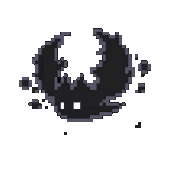
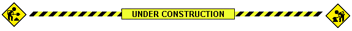

<!--- banner  --->

<!--- me  --->

<table border="0" cellpadding="0" cellspacing="0"
       style="border: none; border-collapse: collapse;">
  <tr>
    <td align="center" style="border: none;">
      
      &nbsp;&nbsp;&nbsp;&nbsp;
      
    </td>

  <td style="border: none;">
      <table border="0" cellpadding="0" cellspacing="0"
             style="border: none; border-collapse: collapse;">
        <tr>
          <td align="center" valign="middle" style="border: none;">
            
          </td>

  <td align="center" valign="middle" style="border: none;">
            <h1>꧁༒Aayush༒꧂</h1>
            <strong>💻 Software Developer</strong>
            
Building things, breaking things, and learning every day.

            
<strong>CODE · LEARN · AI</strong>

          </td>
        </tr>
      </table>
    </td>

  <td align="center" style="border: none;">
      
      &nbsp;&nbsp;&nbsp;&nbsp;
      
    </td>
  </tr>
</table>

## About Me

- Currently in **Raipur**
- From **Rampur, Chhattisgarh**
- Learning **C++**, **Web Development**, and **Animation**
- Interested in **creative coding**, **gaming-style UIs**, and **anime-inspired visuals**
- Goal: become better every day by building real projects

  

